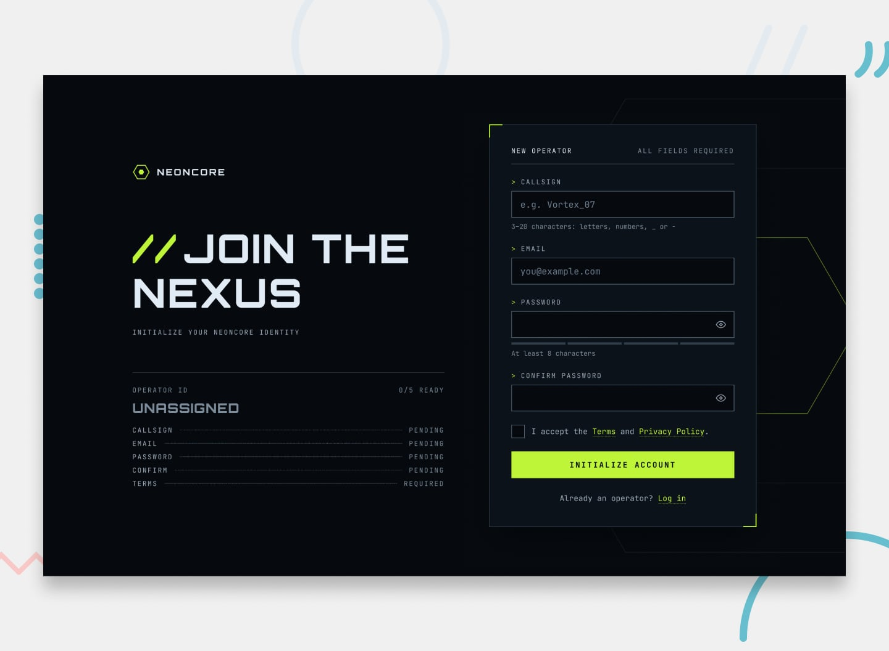

# Project name - description

## Table of Contents

- [Overview](#overview)
  - [Features](#features)
  - [Links](#links)
  - [Tech Stack](#tech-stack)
  - [Project Structure](#project-structure)
- [Architecture & Key Decisions](#architecture--key-decisions)
  - [Component Design](#component-design)
  - [State Management](#state-management)
  - [Utility Functions](#utility-functions)
  - [Accessibility](#accessibility)
- [Author](#author)

## Overview

This is a solution to the [Gamer sign-up form challenge on Frontend Mentor](https://www.frontendmentor.io/challenges/gamer-sign-up-form). Frontend Mentor challenges help you improve your coding skills by building realistic projects. 

### Features

Users should be able to:

- Fill in the form with a callsign, email, password, and password confirmation, and accept the terms
- Receive form validation messages if any field is missed or filled in incorrectly
- Show and hide each password with the eye button
- See a password strength meter update as they type
- See a loading state on the button while the form submits, then a success message
- Complete the form only using their keyboard
- Have inputs, hints, error messages, and the success message announced on their screen reader
- View the optimal layout for the interface depending on their device's screen size
- See hover and focus states for all interactive elements on the page

### Links

- [live demo site]()

### Tech Stack

### Project Structure

## Architecture & Key Decisions

### Component Design

### State Management

### Utility Functions

### Accessibility

## Author

- Website - [Matt Pahuta](https://www.mattpahuta.dev)
- Frontend Mentor - [@mattpahuta](https://www.frontendmentor.io/profile/MattPahuta)
- Bluesky - [@mattpahuta](https://bsky.app/profile/mattpahuta.bsky.social)
- LinkedIn - [Matt Pahuta](www.linkedin.com/in/mattpahuta)
